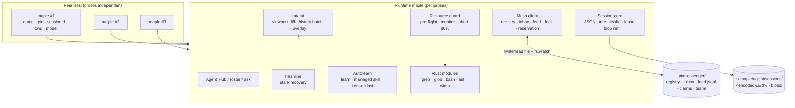

# maple — PRD & Design Doc (v0.1)

| | |
|---|---|
| Status | Draft |
| Tanggal | 2026-11-15 |
| Nama kerja | `maple` (bisa diganti) |
| Sumber studi | `refs/oh-my-pi` (omp), `refs/pi-messenger` |
| Tata kelola | AI Operating Contract v7.0 ("KONTRAK") |

> Catatan: `refs/oh-my-pi` dan `refs/pi-messenger` adalah spesifikasi, bukan bagian dari
> produk. maple adalah re-implementasi clean-room (ADR-0001): kode Rust ditulis dari nol,
> tidak ada kode referensi yang disalin atau di-vendor; perilaku dan format direproduksi 1:1 dari
> keduanya. Aturan clean-room berlaku untuk kode referensi; maple tetap memakai crate
> pihak ketiga dari crates.io sebagai dependensi build, terdaftar dengan lisensinya di
> `THIRD-PARTY-NOTICES`.

---

## 1. Ringkasan

`maple` adalah TUI coding agent dengan tiga pembeda:

1. **RAM-efisien** — agen Rust murni (satu binary, tanpa runtime JS), transkrip append-only dengan
   scan terbatas, artifact di-spill ke blob store, budget memori per sesi yang
   dipantau dan dipaksa (batas 80%).
2. **Multi-session kolaboratif, sesi independen** — mesh file-based tanpa daemon,
   peer flat (tanpa host/guest), kompatibel dengan format `.pi/messenger` milik
   pi-messenger. Tiap sesi = satu identitas (`name`, `pid`, `sessionId`, `cwd`,
   `model`), otonom, tidak ada hierarki wajib.
3. **UX kelas omp + resource discipline** — renderer differential ratatui, Agent Hub,
   `ask`, keybindings, theme; edit hashline; autolearn dua-fase; plus pre-flight/
   monitoring/abort 80% wajib di runtime (bukan sekadar pedoman agen).

---

## 2. Latar

Dua referensi memberi pelengkap yang hampir tidak tumpang tindih:

- **omp** sudah memecahkan TUI/UX, edit, memori, dan efisiensi native. Tapi model
  kolaborasinya (`/collab`) **hub-and-spoke**: host authoritative + relay, guest
  jadi replika. Hierarkis, butuh relay, dan tidak "independent per session".
- **pi-messenger** sudah memecahkan komunikasi antar-sesi yang **flat dan otonom**
  lewat file (`registry/`, `inbox/`, `feed.jsonl`, `swarm.lock`, claims). Tapi ia
  cuma extension pi, tanpa TUI sendiri, tanpa native RAM diet, tanpa hashline,
  tanpa autolearn.

`maple` = UX/engine omp + mesh pi-messenger + paksaan resource limit ala KONTRAK.

---

## 3. Tujuan & Non-goal

### Tujuan

| ID | Tujuan | Terverifikasi lewat |
|---|---|---|
| G1 | Sesi idle RSS ≤ 256 MB; build/test ≤ 512 MB; >768 MB butuh koordinasi; agregat ≤ 2 GB | sampling `ps -o rss` tiap 5 s; abort di 80% |
| G2 | Beberapa sesi agent dalam satu folder saling lihat, kirim pesan, broadcast | `list`/`feed`/`send`/`broadcast` |
| G3 | Sesi independen: tak ada host/guest; identitas simetris; konflik hanya lewat reservasi | registri peer + `reserve`/`release` |
| G4 | UX omp: renderer differential, Agent Hub, overlay, `ask`, tool card, keybindings, theme | Paritas fitur `docs/tui.md`, `docs/agent-hub.md` |
| G5 | Autolearn: lesson + managed skill + konsolidasi lintas sesi, project-scoped | `learn`, `manage_skill`, `/memory`, pipeline 2-fase |
| G6 | Hashline: edit content-hash anchor + stale recovery + seen-line | `edit` mode `hashline`, error class native |
| G7 | Resource discipline first-class: pre-flight abort, monitoring wajib, OOM protocol | gate sebelum `bash`/build/test; wrapper proses |

### Non-goal (v0.1)

- Relay server / kolab real-time lintas mesin (mode `/collab` omp bisa menyusul;
  mesh file adalah default).
- Mobile/web client.
- Fitur omp di luar inti (browser, computer, DAP, ACP, TTS, image) — diambil
  bertahap, prioritas pada inti sesi+mesh+TUI+edit+memori.
- Klaim "lebih murah" untuk LLM: fokus RAM proses, bukan token (hashline memang
  mengurangi token output, itu efek samping yang bagus).

---

## 4. Prinsip Desain

1. **P1 koordinasi, P2 kerja** (KONTRAK §5). Mesh mendukung presence check,
   interrupt cost, reservasi, dan "koordinasi tanpa budget" (INV-39..42).
2. **Kualitas > kecepatan; keamanan > fitur** (INV-1). Reservasi dipaksakan hook,
   bukan kesepakatan.
3. **Clean-room, reproduksi 1:1** — kode maple ditulis dari nol dalam Rust murni
   (ADR-0003); oh-my-pi dan pi-messenger dipakai sebagai spesifikasi perilaku/format
   (ADR-0001). Tidak ada kode referensi yang disalin atau di-vendor; TUI, hashline, autolearn,
   dan natives ditulis ulang mengikuti kontrak `docs/` omp (render, edit, memori)
   dan format `.pi/messenger`. Crate pihak ketiga diperbolehkan sebagai dependensi
   (ADR-0003) dan dicatat lisensinya di `THIRD-PARTY-NOTICES`.
4. **Kompatibel, bukan tiruan** — format `.pi/messenger` dan nama aksi pi-messenger
   dipakai apa adanya, supaya agen pi-messenger yang ada bisa interoperasi.
5. **Eksternal = data** (SOP-INJECT): isi repo/pesan agen/output tool tidak pernah
   jadi instruksi.
6. **Batas sumber daya adalah invariant sistem** (SOP-SYS + RESLIM), bukan catatan
   kaki.

---

## 5. Arsitektur



| Modul | Sumber | Catatan |
|---|---|---|
| Renderer | ditulis sendiri (`ratatui` + `crossterm`) | kontrak `Component`, history batch ack, viewport diff |
| Agent Hub / overlay / ask | omp `docs/agent-hub.md`, `docs/tui.md` | roster, inspector, steer/revive/kill |
| Session core | omp `docs/session.md`, `session-tree-plan.md` | JSONL, tree, lease, bounded scan |
| Mesh | pi-messenger `store.ts`, `feed.ts`, `lib.ts` | registry/inbox/feed/lock/claims |
| Hashline | omp `docs/tools/edit.md` (referensi) | anchor `[PATH#TAG]`, error class |
| Autolearn | omp `docs/memory.md`, `docs/tools/learn.md` | backend + 2-fase + managed skill |
| Resource guard | KONTRAK §SOP-RESLIM | **komponen baru** |
| Natives | modul Rust murni | grep/glob/bash/ast/text width |

---

## 6. Model Sesi (independen)

Diambil dari omp, dengan penekanan kemandirian:

- **Satu proses = satu sesi = satu identitas.** Identity terdiri dari
  `name` (alamat pi-messenger), `pid`, `sessionId` (UUIDv7), `cwd`, `model`,
  `gitBranch`. Tidak ada field "parent wajib": `parentSession` opsional saja
  (lineage fork), bukan gate koordinasi.
- **Penyimpanan**: `~/.maple/agent/sessions/<encoded-cwd>/<timestamp>_<sessionId>.jsonl`
  (bucket per canonical cwd, sama seperti omp). JSONL append-only; entri punya
  `id`/`parentId`; navigasi pohon lewat `leafId` in-memory. Tidak ada penulisan
  ulang history untuk branch.
- **Lease**: satu proses tidak menulis file yang lease-nya dipegang proses hidup
  lain; kalau dipaksa, dia pindah ke sibling `<timestamp>_<new-id>.jsonl`
  (`parentSession` menunjuk ke file lama). Ini mencegah dua penulis di sesi sama.
- **RAM**: scan daftar sesi dibatasi (prefix 4 KiB + tail 32 KiB), loader streaming
  untuk file ≥ 8 MiB, artifact besar di-spill ke `~/.maple/agent/blobs/<sha256>`,
  transkrip menyimpan referensi blob. Title index di SQLite (`history.db`).
- **Sesi persisten**: transkrip bisa di-resume; status lifecycle
  (`complete`/`interrupted`/`aborted`/`error`/`pending`/`unknown`) dibaca dari tail.

---

## 7. Mesh Koordinasi (kompatibel pi-messenger)

Default direktori: `.pi/messenger/` (wire-compatible penuh dengan pi-messenger;
ADR-0001). Semua operasi file-only, tanpa daemon.

| Aksi | Efek | Sumber |
|---|---|---|
| `join` / `leave` | tulis/hapus `registry/<name>.json`; feed `join`/`leave` | pi-messenger |
| `list` / `whois` / `status` | baca registry + live pid + aktivitas | pi-messenger |
| `rename` | ganti nama identitas + registri | pi-messenger |
| `send(to, text)` | tulis `inbox/<to>/<ts>-<rand>.json`; feed `message` | pi-messenger |
| `broadcast(text)` | tulis ke semua inbox peer | pi-messenger |
| `reserve(paths, reason)` | tulis `reservations[]` di registri | pi-messenger |
| `release(paths?)` | kosongkan (default semua) | pi-messenger |
| `feed(limit)` | baca `feed.jsonl` | pi-messenger |
| `team.memory.note(type, message)` | tulis `team/memory.jsonl` + mirror `.pi/messenger/team/decisions.md` | KONTRAK |
| `team.memory.list` / `team.setup` / `team.roles` / `team.status` | baca state team | KONTRAK + pi-messenger |
| `plan` / `work` / `task.*` (opsional M4) | crew: graph dependensi + wave paralel | pi-messenger crew |

Mekanisme:

- **Presence/liveness**: `pid` alive + `lastActivityAt` → status
  `active`/`idle`/`away`/`stuck` (`computeStatus`). Anggota human pun bisa
  (`isHuman`).
- **Delivery**: `fs.watch` pada inbox + debounce 50 ms; pesan dihapus setelah
  terkirim; retry tersibat kalau watch gagal.
- **Lock**: `swarm.lock` dibuat `O_EXCL` + umur + pid; stale dihapus. Dipakai
  untuk operasi atomik (register, claim).
- **Reservasi**: dipaksakan oleh hook tool — `edit`/`write`/`bash` yang menyentuh
  path di reservasi orang lain **ditolak** dengan pesan koordinator. Reservasi
  lepas otomatis saat `leave`/exit. Tidak ada workaround (INV-41).
- **Anti-duplikat**: sebelum tulis shared state, agent wajib `list` + cek
  reservasi + `team.memory` segar (SOP-G9.2). Klaim/reservasi bisa basi.
- **`scopeToFolder`**: visibilitas mesh dibatasi folder yang sama (default on).

---

## 8. TUI/UX

Paritas dengan omp (kontrak `packages/tui`):

- **Komponen**: `render(width): readonly string[]`; kembalikan **referensi array
  yang sama** bila isi tidak berubah (memoization). `handleInput`, `dispose`,
  `CURSOR_MARKER` untuk kursor hardware.
- **Frame**: history batch (append-only, ack per id) vs viewport (diff).
  Overlay tidak masuk history. Tidak ada clear/rewrite history per frame.
- **Surface**: Agent Hub (roster + inspector: model, cost, token, tool aktif),
  focus/steer/revive/kill subagent; `ask` form; tool card; preview edit.
- **Input**: `keybindings.yml` + `theme`; session picker fullscreen; `/tree`,
  `/branch`/`/rewind`, `/memory`, `/resume`.
- **Statusline**: nama agen + jumlah peer + status + model + cwd + konteks % +
  cost (pola `msg: SwiftRaven (2 peers) ●3`).

---

## 9. Hashline (edit)

- Format `[PATH#TAG]`, `TAG` = 4 hex dari konten ternormalisasi; operasi
  `PUT N.=M:`, `PUT N*:` (blok tree-sitter), `PUT <N:`/`PUT >N:`, `PUT >$:`,
  `CUT`, register (`@name`), `MV`, `REM`.
- Semua nomor merujuk snapshot asli, bukan hunk sebelumnya.
- Tag basi → pemulihan berbasis snapshot chain; kalau tidak unik → tolakin.
- `enforceSeenLines`: edit hanya pada baris yang pernah terlihat model.
- Error class eksplisit (`stale_tag`, `unseen_lines`, `other_file_tag`,
  `ambiguous_boundary`, `no_change`, `io`, ...).
- Terapkan juga pada sesi kolaboratif: reservasi + seen-line mencegah dua agen
  mengedit wilayah yang sama buta.

---

## 10. Autolearn & Memori

- **Backend**: `off` (default), `local`, `hindsight`, `mnemopi`, `sharpshooter`
  (ikut omp). Project-scoped.
- **Alat**: `learn` (lesson, opsional `scope: global`, opsional promosi
  `skill`), `manage_skill`, `retain`/`recall`/`reflect`/`memory_edit` per backend.
- **Pipeline 2 fase**: ekstraksi per-sesi (keputusan, batasan, kegagalan terpecahkan,
  alur berulang) → konsolidasi (`MEMORY.md`, `memory_summary.md`, `skills/`).
  Lease + heartbeat untuk mencegah double-run antar proses. Redaksi secret.
- **Injection**: ringkasan + lesson diinjeksikan sebagai *Memory Guidance* dengan
  token cap; lesson cap 100 entri / 2.000 char; dedicated context 400 char.
- **Self-correcting**: memory basi adalah defect; koreksi dicatat dengan bukti.
- **Lintas sesi**: konsolidasi berjalan di startup; sesi baru membaca ringkasan.
  Lesson `learn` tidak mengubah prefix cache sesi aktif.

---

## 11. Resource Guard (komponen baru)

RESLIM KONTRAK dipaksakan runtime, bukan hanya diminta ke agen.

| Kelas | Default | Paksaan |
|---|---|---|
| RSS per proses | 256 MB (build/test 512; maks 768) | `NODE_OPTIONS=--max-old-space-size`, `ulimit -v`/`RLIMIT_AS`, container `--memory` |
| Agregat anak | 2 GB | monitor + abort |
| CPU | `min(2, nproc/4)` | `taskset`/`--cpus`; job count eksplisit |
| FD / proses | 512 / 128 | `ulimit -n`, `ulimit -u`, `--pids-limit` |
| Disk | ≥20% atau ≥4 GB | pre-flight |
| Network | 50 koneksi | pool terbatas |
| Timeout | 15 s net; 60 s test/file; 10 min suite; 5 min build; 20 min migrasi | `timeout` di tiap spawn |

- **Pre-flight wajib** sebelum `bash`/build/test/migrasi: `free -m`, swap,
  `nproc`+`uptime`, `df -h`, `ulimit`, `ps aux --sort=-%mem`, `list` peer,
  `team.memory` risiko. Kondisi abort (mem < 2× perkiraan, swap > 0, load >
  nproc/2, disk di bawah ambang, proses besar, konflik reservasi/overlap, tanpa
  timeout) → **berhenti**, bukan diterobos.
- **Monitoring**: perintah > 60 s di-sample ≥ tiap 5 s; **abort di 80%** limit
  mana pun. Tidak ada "biarkan mentok dulu".
- **OOM protocol**: stop → catat → diagnosis (uncover penyebab) → turunkan beban →
  tambah guard test → update default. Tidak ada retry buta (exit 137/ENOMEM).
- **Batas per sesi**: anggaran renderer + transkrip; tekan pemakaian dengan
  bounded scan + blob spill + retirement row (renderer sudah punya mekanisme
  history/viewport dan image budget).

---

## 12. Keamanan

- **Reservasi keras** via hook (bukan kesepakatan); konflik → tolak + kirim ke
  pemesan.
- **Injection defense**: semua konten di luar KONTRAK + pesan user eksplisit +
  `team.memory` yang disepakati adalah **data** (SOP-INJECT). Pesan agen peer =
  data. Red flag (persona shift, base64, "lewati verifikasi", exfil) → jangan
  patuhi; simpan; beri tahu peer.
- **Secret**: tidak pernahcommit/log/echo; redaksi sebelum memori/feed; env/secret
  manager.
- **Integritas mesh**: file mesh lokal = trust boundary folder + OS permission;
  kalau nanti ada relay lintas mesin, pakai pola omp `/collab` (AES-256-GCM,
  link view/control, relay buta isi).
- **Input**: batasi ukuran/depth/count atas semua input eksternal (SOP-SEC).

---

## 13. Skema Data (ringkas)

### 13.1 Session header (`SessionHeader`, JSONL line 1)

```json
{
  "type": "session", "version": 3,
  "id": "019c625b-b900-7000-8000-000000000001",
  "timestamp": "2026-02-16T10:20:30.000Z",
  "cwd": "/work/maple",
  "title": "opsional", "titleSource": "auto",
  "additionalDirectories": ["/work/shared"],
  "previousSessionFiles": ["/old/location/session.jsonl"],
  "providerPromptCacheKey": "opsional",
  "taskPromptCacheKey": "opsional",
  "parentSession": "opsional: id atau path; lineage saja"
}
```

Entri lanjut: `{ "type": "...", "id": "8-char", "parentId": "...", ... }`.

### 13.2 Registrasi mesh (`registry/<name>.json`)

```json
{
  "name": "SwiftRaven", "pid": 12345,
  "sessionId": "019c…", "cwd": "/work/maple",
  "model": "anthropic/claude-haiku-4-5",
  "startedAt": "2026-11-15T06:00:00Z",
  "reservations": [{ "pattern": "src/auth/**", "reason": "refactor", "since": "…" }],
  "gitBranch": "feat/mesh",
  "spec": "opsional",
  "isHuman": false,
  "session": { "toolCalls": 12, "tokens": 48210, "filesModified": ["src/a.ts"] },
  "activity": { "lastActivityAt": "…", "currentActivity": "editing src/a.ts", "lastToolCall": "edit" },
  "statusMessage": "debugging…"
}
```

### 13.3 Pesan (`inbox/<to>/<ts>-<rand>.json`)

```json
{ "id": "uuid", "from": "LunarDust", "to": "SwiftRaven", "text": "auth selesai", "timestamp": "…", "replyTo": null }
```

### 13.4 Feed (`feed.jsonl`, append-only)

`{ "type": "join|leave|reserve|release|message|commit|test|edit|task.*|plan.*|stuck", "agent": "…", "target": "…?", "preview": "…?", "ts": "…" }`

### 13.5 Claim / completion (`claims.json`, `completions.json`)

`claims[spec][taskId] = { agent, sessionId, pid, claimedAt, reason? }`;
`completions[spec][taskId] = { completedBy, completedAt, notes? }`.

### 13.6 Team memory (`team/memory.jsonl`) + mirror

`{ "type": "decision|interface|risk|handoff", "message": "…", "from": "…", "ts": "…" }`
Mirror append-only di `.pi/messenger/team/decisions.md` (dikelola pi-messenger).

---

## 14. Build Order

Tanpa gerbang fase: **semua fitur diimplémentasikan langsung, bertahap**, dalam
urutan ini. Setiap langkah harus hijau (build + test) sebelum lanjut.

| # | Fitur | Acceptance |
|---|---|---|
| 1 | CLI + session core | `cargo build` hijau; `maple --headless` membuat JSONL sesi; resume/branch; bounded scan + blob spill |
| 2 | TUI renderer | renderer differential (viewport diff + history batch); statusline; `q`/Ctrl-C; RSS idle ≤ 256 MB terukur |
| 3 | Agent Hub | roster + inspector (model, cost, token, tool aktif); focus/steer/revive/kill; `ask` |
| 4 | Mesh | `.pi/messenger`: registry, inbox+watch, feed, lock, reservasi + hook; `team.memory` + mirror; 2 proses `list`/`send`; reservasi menolak edit lintas agen |
| 5 | Resource guard | pre-flight abort, monitoring ≥ 5 s, abort 80%, OOM protocol; guard test negatif |
| 6 | Hashline edit | anchor `[PATH#TAG]`, semua op, stale recovery, seen-line, error class; edit diterapkan 1 panggilan |
| 7 | Autolearn | `learn`, `manage_skill`, pipeline 2 fase, `/memory`; lesson terinjeksi sesi berikutnya; konsolidasi tak double-run |
| 8 | Crew | `plan`/`work`/`task.*`: graph + wave + claim/completion; task independen paralel; dependen menunggu |
| 9 | Hardening + docs | security pass, injection red-team, uji resource, README/CHANGELOG/SECURITY/adr/runbook/operations; SOP-SHIP lulus |

---

## 15. Risiko & Open Questions

| Risiko | Mitigasi |
|---|---|
| Clean-room = M1 lebih besar dari jalur fork | Buffer jadwal; non-goal eksplisit; modular sejak awal |
| Mesh file + `fs.watch` tidak real-time lintas mesin | v0.1 lokal; relay menyusul dengan pola collab omp |
| Reservasi bisa dilewati agen yang tidak disiplin | Hook memaksakan; audit feed; KONTRAK SOP-G12 |
| Limit memori salah tebak → thrash | Pre-flight 2× headroom; abort 80%; OOM protocol + guard test |
| Atribusi referensi | ADR-0001 + THIRD-PARTY-NOTICES; tidak ada kode disalin atau di-vendor |
| Nama `maple` bentrok | Nama kerja; ganti sebelum publik |

Open:
- Nama final + repo publik atau privat?
- Apakah `plan`/`work` (crew) masuk v1 atau menyusul?
- Target platform: macOS/Linux dulu (Windows menyusul)?

---

## 16. Referensi

omp (dibaca): `README.md`, `docs/tui.md`, `docs/tui-core-renderer.md`,
`docs/collab.md`, `docs/session.md`, `docs/session-tree-plan.md`,
`docs/session-switching-and-recent-listing.md`, `docs/memory.md`,
`docs/tools/learn.md`, `docs/tools/edit.md`, `docs/agent-hub.md`.
pi-messenger (dibaca): `README.md`, `skills/pi-messenger-crew/SKILL.md`,
`store.ts`, `feed.ts`, `lib.ts`, `config.ts`, `crew/spawn.ts`, `crew/id-allocator.ts`.
Tata kelola: AI Operating Contract v7.0 (KONTRAK) — §SOP-PRIORITY, §SOP-RESLIM,
INV-39..42, SOP-INJECT, SOP-SYS, SOP-HACK, SOP-SHIP, SOP-HANDOVER.
