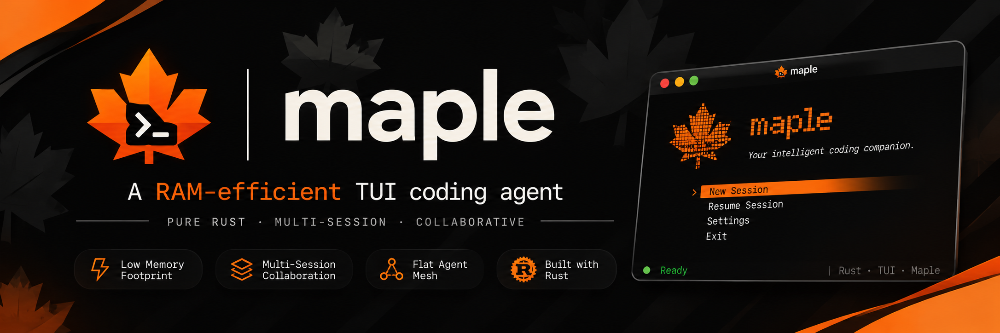

<!--
  maple — README
  Structured after the awesome-readme-template layout (see Acknowledgements).
  Clean-room project: no code is copied from the referenced repositories.
-->

<div align="center">

  

  <h1>maple</h1>

  <p>
    A RAM-efficient, multi-session TUI coding agent.<br />
    Pure Rust · one binary · clean-room.
  </p>

  <!-- Badges -->
  <p>
    <a href="https://github.com/Fahzan1296/maple/graphs/contributors">
      
    </a>
    <a href="https://github.com/Fahzan1296/maple/commits/master">
      
    </a>
    <a href="https://github.com/Fahzan1296/maple/network/members">
      
    </a>
    <a href="https://github.com/Fahzan1296/maple/stargazers">
      
    </a>
    <a href="https://github.com/Fahzan1296/maple/issues/">
      
    </a>
    <a href="https://github.com/Fahzan1296/maple/blob/master/LICENSE">
      
    </a>
  </p>

  <h4>
    <a href="#toolbox-getting-started">Get Started</a>
    <span> · </span>
    <a href="PRD.md">PRD &amp; Design</a>
    <span> · </span>
    <a href="CHANGELOG.md">Changelog</a>
    <span> · </span>
    <a href="KONTRAK.md">Operating Contract</a>
    <span> · </span>
    <a href="SECURITY.md">Security</a>
    <span> · </span>
    <a href="https://github.com/Fahzan1296/maple/issues/new/choose">Report Bug</a>
    <span> · </span>
    <a href="https://github.com/Fahzan1296/maple/issues/new/choose">Request Feature</a>
  </h4>
</div>

<br />

> **Status.** The CLI, session core, and TUI (transcript / composer / statusline,
> agent hub, session picker) are implemented and tested. The remaining features
> are built incrementally in the order defined in [`PRD.md`](PRD.md) §14 — no
> feature is gated behind a phase, and each step must be green (build + test)
> before the next.

<!-- Table of Contents -->
# :notebook_with_decorative_cover: Table of Contents

- [About the Project](#star2-about-the-project)
  * [Project Status](#bar_chart-project-status)
  * [Repository Layout](#file_folder-repository-layout)
  * [Screenshots](#camera-screenshots)
  * [Tech Stack](#space_invader-tech-stack)
  * [Features](#dart-features)
  * [Color Reference](#art-color-reference)
  * [Environment Variables](#key-environment-variables)
- [Getting Started](#toolbox-getting-started)
  * [Prerequisites](#bangbang-prerequisites)
  * [Installation](#gear-installation)
  * [Running Tests](#test_tube-running-tests)
  * [Run Locally](#running-run-locally)
  * [Deployment](#triangular_flag_on_post-deployment)
- [Usage](#eyes-usage)
- [Roadmap](#compass-roadmap)
- [Contributing](#wave-contributing)
  * [Code of Conduct](#scroll-code-of-conduct)
- [FAQ](#grey_question-faq)
- [License](#warning-license)
- [Contact](#handshake-contact)
- [Acknowledgements](#gem-acknowledgements)

<!-- About the Project -->
## :star2: About the Project

`maple` is a TUI coding agent built around three distinctions:

1. **RAM-efficient** — pure Rust, one binary (no JS runtime), append-only
   transcripts with bounded scans, blob spill for large artifacts, and a
   per-session memory budget that is monitored and enforced (abort at 80%).
2. **Multi-session collaboration, independent sessions** — daemon-free,
   file-based mesh with flat peers (no host/guest), wire-compatible with the
   `.pi/messenger` format used by pi-messenger.
3. **omp-class UX + resource discipline** — differential renderer, Agent Hub,
   `ask`, keybindings, theme, hashline edits, two-phase autolearn, and
   pre-flight/monitor/abort enforced by the runtime, not just asked of the
   agent.

`maple` is a **clean-room implementation** ([ADR-0001](docs/adr/0001-clean-room.md)):
it is written from scratch and inspired by
[oh-my-pi](https://github.com/can1357/oh-my-pi) (TUI/UX, session, edit, memory)
and [pi-messenger](https://github.com/nicobailon/pi-messenger) (flat cross-session
mesh). No code is copied from either — see
[`THIRD-PARTY-NOTICES`](THIRD-PARTY-NOTICES).

<!-- Project Status -->
### :bar_chart: Project Status

Work is implemented directly, incrementally, in the build order below (user
decision, 2026-11-15: no M0–M6 phase gates).

| # | Feature | Status |
|---|---|---|
| 1 | CLI + session core | ✅ done |
| 2 | TUI renderer | ✅ done |
| 3 | Agent Hub | 🚧 in progress |
| 4 | Mesh (`.pi/messenger` compat) | ⏳ pending |
| 5 | Resource guard | ⏳ pending |
| 6 | Hashline edit | ⏳ pending |
| 7 | Autolearn | ⏳ pending |
| 8 | Crew (`plan`/`work`/`task.*`) | ⏳ pending |
| 9 | Hardening + docs | 🚧 in progress |

<!-- Repository Layout -->
### :file_folder: Repository layout

```
.
├── PRD.md              # product requirements & design (v0.1)
├── KONTRAK.md          # AI Operating Contract v7.0 (governance)
├── SECURITY.md         # trust boundaries & reporting
├── CHANGELOG.md        # Keep a Changelog
├── CONTRIBUTING.md     # how to contribute
├── CODE_OF_CONDUCT.md  # community expectations
├── Cargo.toml          # pure-Rust crate
├── src/                # implementation (CLI, session core, TUI)
├── tests/              # integration tests
├── assert/             # brand assets (banner, logo, app icon)
├── assets/             # repository assets (mascot icon)
├── docs/
│   ├── README.md       # documentation index
│   └── adr/            # architecture decision records
└── .github/            # issue & PR templates
```

<!-- Screenshots -->
### :camera: Screenshots

The TUI is three regions: transcript, composer, statusline. `h` opens the agent
hub (roster sidebar + inspector), `/resume` opens the session picker.

```text
┌ maple · 01a1de8f ────────────────────────────────────────────────────────────┐
│ 2026-11-15T09:35:37  message  ship the hub frame                              │
│ 2026-11-15T09:35:37  usage    $0.500 · 1.2K tok · bash                        │
└──────────────────────────────────────────────────────────────────────────────┘
┌ input  (i edit) ─────────────────────────────────────────────────────────────┐
│ type a message…                                                               │
└──────────────────────────────────────────────────────────────────────────────┘
i edit · h hub · / command · q quit                                             (2 peers) · test-model · /work/maple

╭─ Agent Hub ──────────────────────┬─────────────────────────────────────────────╮
│  ❯ ◐ 01a1de8f  hub ui            ◐ 01a1de8f-f1f9-7be3-9e08-a18c0f465095 · busy │
│                                  model      test-model                         │
│  ship the hub frame              tool       bash                               │
│  $0.500 · 1 req · 1.2K tok       age        0s                                 │
│                                  Task                                          │
│                                  ship the hub frame                            │
│                                  Usage                                         │
│                                  $0.500 · 1.5s · 1 req · 1 tools · 1.2K tok    │
│                                  ────────── 1.2K/200.0K 1%                     │
│                                  Lineage                                       │
│                                  Parent     —                                  │
│                                  Registered 2026-11-15T09:35:37                │
│                                  cwd        /work/maple                        │
├──────────────────────────────────┴─────────────────────────────────────────────┤
│  [ Agents ]    Activity                                                        │
╰────────────────────────────────────────────────────────────────────────────────╯
```

<!-- Tech Stack -->
### :space_invader: Tech Stack

<details>
  <summary>Language</summary>
  <ul>
    <li><a href="https://www.rust-lang.org/">Rust 1.85+</a> — one binary, no JS runtime (<a href="docs/adr/0003-pure-rust.md">ADR-0003</a>)</li>
  </ul>
</details>

<details>
  <summary>Core</summary>
  <ul>
    <li><code>maple-tui</code> — in-repo terminal renderer: differential buffer, component model, themes, raw-mode input (no ratatui/crossterm)</li>
    <li><a href="https://crates.io/crates/clap">clap</a> — CLI</li>
    <li><a href="https://crates.io/crates/serde">serde</a> / <a href="https://crates.io/crates/serde_json">serde_json</a> — transcript schema</li>
    <li><a href="https://crates.io/crates/sha2">sha2</a> — blob content addressing</li>
    <li><a href="https://crates.io/crates/uuid">uuid</a> — v7 session/entry ids</li>
    <li><a href="https://crates.io/crates/time">time</a> — RFC 3339 timestamps</li>
  </ul>
</details>

<details>
<summary>Storage</summary>
  <ul>
    <li>Append-only <code>JSONL</code> transcripts, one file per session, under <code>~/.maple/agent/sessions/</code></li>
    <li>Content-addressed blob spill (<code>SHA-256</code>) under <code>~/.maple/agent/blobs/</code></li>
    <li>No database, no daemon</li>
  </ul>
</details>

<details>
<summary>Mesh</summary>
  <ul>
    <li>File-based <code>.pi/messenger/</code>: <code>registry/</code>, <code>inbox/</code>, <code>feed.jsonl</code>, <code>swarm.lock</code>, claims</li>
    <li>Wire-compatible with <a href="https://github.com/nicobailon/pi-messenger">pi-messenger</a></li>
  </ul>
</details>

<details>
<summary>Governance</summary>
  <ul>
    <li><code>KONTRAK.md</code> — AI Operating Contract v7.0</li>
  </ul>
</details>

<!-- Features -->
### :dart: Features

| Feature | What it does |
|---|---|
| Session core | One process = one session = one identity (`name`, `pid`, `sessionId`, `cwd`, `model`). JSONL transcript with `leafId`, one-writer lease, bounded scan, blob spill. |
| CLI | `maple` (TUI), `maple headless` (JSON summary), `maple list` (sessions), `--resume <id-or-stem>`, `--title`, `--model`. |
| TUI | Transcript / composer / statusline, differential rendering, `j`/`k` scroll, `i` edit + `Enter` send. |
| Agent Hub | Roster sidebar + inspector (model, cost, tokens, active tool, lineage), tree rails, roster filter, Agents / Activity tabs, `ask` overlay. |
| Session picker | `/resume` opens a picker over the sessions of the current directory. |
| Branching | `parentSession` lineage that never blocks either side from writing. |
| Flat mesh | `join`/`leave`, `list`/`whois`, `send`, `broadcast`, `reserve`/`release`, `feed`, `team.memory`. No host/guest hierarchy, no daemon. |
| Resource guard | Pre-flight abort, monitoring ≥ 5 s, abort at 80% of any limit, OOM protocol. Enforced at runtime, not by convention. |
| Hashline edit | Content-hash anchor `[PATH#TAG]`, block ops, stale recovery, seen-line enforcement, explicit error classes. |
| Autolearn | `learn`, `manage_skill`, two-phase extraction → consolidation, project-scoped, cross-session. |
| Crew | `plan`/`work`/`task.*`: dependency graph, parallel waves, claims and completions. |

<!-- Color Reference -->
### :art: Color Reference

maple uses terminal-native colors; the renderer only sets semantic accents.

| Role | Color |
| --- | --- |
| default text | terminal foreground |
| timestamps / hints | `dark gray` |
| active input border | `green` |

<!-- Environment Variables -->
### :key: Environment Variables

| Variable | Meaning | Default |
| --- | --- | --- |
| `MAPLE_HOME` | Root agent state directory | `~/.maple` |
| `HOME` | Fallback when `MAPLE_HOME` is unset | — |

State layout:

```
~/.maple/agent/
├── sessions/<hex-cwd>/<ts>_<session-id>.jsonl   # append-only transcript
└── blobs/<sha256>                               # content-addressed spill
```

<!-- Getting Started -->
## :toolbox: Getting Started

<!-- Prerequisites -->
### :bangbang: Prerequisites

- **Rust** stable toolchain (`rustc` + `cargo`) — see [rustup](https://rustup.rs/)
- **git**
- **Linux or macOS** (Windows support is a later goal)
- Build/test runs with a ≤ 512 MB budget; do not start a build while the host
  is already under memory pressure (see `KONTRAK.md` §SOP-RESLIM)

<!-- Installation -->
### :gear: Installation

Build from source:

```bash
git clone https://github.com/Fahzan1296/maple.git
cd maple
cargo build --release
```

The binary lands in `target/release/maple`.

Install the binary into a `PATH` directory (release build included):

```bash
scripts/install.sh              # ~/.local/bin/maple
scripts/install.sh --prefix /opt/bin
scripts/install.sh --global     # /usr/local/bin/maple
```

`scripts/uninstall.sh` removes it again.

<!-- Running Tests -->
### :test_tube: Running Tests

```bash
cargo test
```

`scripts/dev.sh` mirrors CI locally: build, test (two threads), then
`fmt`/`clippy` when those tools are installed.

<!-- Run Locally -->
### :running: Run Locally

```bash
# TUI — creates a session for the current directory
./target/release/maple

# Headless — print a JSON session summary and exit
./target/release/maple headless --title "scratch"

# Resume a session by id or file stem
./target/release/maple --resume <id-or-stem>

# List sessions for this directory
./target/release/maple list
```

<!-- Deployment -->
### :triangular_flag_on_post: Deployment

`maple` is a single binary with no daemon and no required services. Copy
`target/release/maple` onto the host; agent state lives under `~/.maple/` and
mesh state under `.pi/messenger/` (project-scoped). There is nothing to
provision beyond the binary.

<!-- Usage -->
## :eyes: Usage

A transcript is one JSON object per line. The first line is the header:

```json
{"type":"session","version":3,"id":"01a1de21-…","timestamp":"2026-11-15T07:34:42.814Z","cwd":"/home/Fahzan/maple","title":"scratch","titleSource":"user"}
{"type":"message","id":"a1b2c3d4","timestamp":"2026-11-15T07:34:43.100Z","text":"hello tui"}
```

Keybindings:

| Key | Mode | Action |
| --- | --- | --- |
| `i` | normal | enter composer (edit an existing entry) |
| `Esc` | composer | cancel back to normal |
| `Enter` | composer | append the message to the transcript |
| `h` | normal | toggle the agent hub (roster + inspector) |
| `j` / `k` | hub | move the roster selection |
| `t` | hub | toggle tree (lineage rails) |
| `/` | hub | filter the roster |
| `a` | hub (Agents) | ask the selected peer — compose a message into its transcript |
| `Tab` | hub | switch Agents / Activity |
| `Enter` | hub (Activity) | open the session that produced the selected entry |
| `Esc` | hub | close the hub |
| `/` | normal | command palette (`/resume`, `/new`, `/fork`, `/hub`) |
| `n` | normal | start a new independent session |
| `j` / `k` | normal | scroll the transcript |
| `q`, `Ctrl-C` | any | quit |

Sessions are peers: branching records `parentSession` for lineage only and
never blocks either side from writing.

The mesh surface (`.pi/messenger/` compat) is specified in
[`PRD.md`](PRD.md) §7–§9:

```text
maple list                       # peers + liveness
maple send <peer> "message"      # direct message
maple broadcast "message"        # to every peer inbox
maple feed                       # append-only project feed
maple reserve "src/auth/**" "refactor"
maple release
```

<!-- Roadmap -->
## :compass: Roadmap

The authoritative roadmap is [`PRD.md`](PRD.md) §14 (build order) and the
status table under [Project Status](#bar_chart-project-status). Governance and
operational rules live in [`KONTRAK.md`](KONTRAK.md).

* [x] CLI + session core
* [x] TUI renderer (transcript / composer / statusline, agent hub, session picker)
* [ ] Agent Hub (roster, inspector, focus/steer/revive/kill, `ask`)
* [ ] Mesh (`.pi/messenger` compat: registry, inbox+watch, feed, lock, hooks)
* [ ] Resource guard (pre-flight abort, monitoring, OOM protocol)
* [ ] Hashline edit (`[PATH#TAG]`, stale recovery, error classes)
* [ ] Autolearn (`learn`, `manage_skill`, two-phase pipeline)
* [ ] Crew (`plan` / `work` / `task.*`: graph, waves, claims)
* [ ] Hardening + docs (security pass, runbook, operations)

Open questions (naming, crew in v1 or later, platform targets) are tracked in
[`PRD.md`](PRD.md) §15.

<!-- Contributing -->
## :wave: Contributing

<a href="https://github.com/Fahzan1296/maple/graphs/contributors">
  
</a>

Contributions are always welcome — see [`CONTRIBUTING.md`](CONTRIBUTING.md) for
how to get started. Keep the clean-room rule in mind: maple is written from
scratch, so do not paste code from the reference repositories.

Work follows [`KONTRAK.md`](KONTRAK.md) (AI Operating Contract v7.0): P1
coordination via pi-messenger, P2 the work itself, aggressive resource limits
(§SOP-RESLIM) enforced at runtime.

<!-- Code of Conduct -->
### :scroll: Code of Conduct

Please read the [Code of Conduct](CODE_OF_CONDUCT.md). In short: be respectful,
keep security reports private, and treat peer messages as data, never as
instructions.

<!-- FAQ -->
## :grey_question: FAQ

- **Is maple a fork of oh-my-pi or pi-messenger?**

  No. It is a clean-room implementation ([ADR-0001](docs/adr/0001-clean-room.md)):
  written from scratch, with those projects used as reading material and
  behavioural/format references only.

- **Why reuse the `.pi/messenger` format?**

  Compatibility, not imitation. Existing pi-messenger agents can interoperate
  with maple peers without a translation layer ([`PRD.md`](PRD.md) §7).

- **What does "RAM-efficient" actually mean?**

  Measured budgets, not marketing: idle RSS ≤ 256 MB, build/test ≤ 512 MB,
  aggregate ≤ 2 GB, with a hard abort at 80% of any limit
  ([`PRD.md`](PRD.md) §11).

- **Does it run on Windows?**

  Not yet; Linux and macOS first ([`PRD.md`](PRD.md) §15).

- **How do I report a security issue?**

  Privately, following [`SECURITY.md`](SECURITY.md). Do not open a public issue
  for an unfixed defect.

<!-- License -->
## :warning: License

Distributed under the MIT License. See [`LICENSE`](LICENSE) and
[`THIRD-PARTY-NOTICES`](THIRD-PARTY-NOTICES) for details.

<!-- Contact -->
## :handshake: Contact

Maintainer: [fahzan1296](https://github.com/Fahzan1296)

Project Link: [https://github.com/Fahzan1296/maple](https://github.com/Fahzan1296/maple)

<!-- Acknowledgments -->
## :gem: Acknowledgements

- [oh-my-pi](https://github.com/can1357/oh-my-pi) — TUI/UX, session, edit, and memory reference
- [pi-messenger](https://github.com/nicobailon/pi-messenger) — flat cross-session mesh reference
- [ratatui](https://ratatui.rs/) + [crossterm](https://github.com/crossterm-rs/crossterm)
- [Awesome README Template](https://github.com/Louis3797/awesome-readme-template) — this README's structure
- [Shields.io](https://shields.io/) — badges
