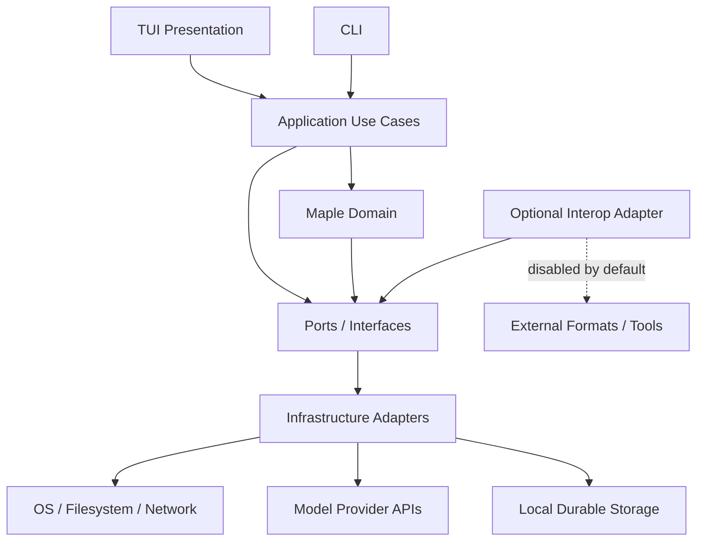

# 02 — Architecture Principles and Dependency Rules

## 1. Logical architecture

## 2. Dependency constraints

- Domain modules depend only on standard/core types and narrowly selected foundational crates.
- Application services depend on domain types and ports, not concrete adapters.
- Infrastructure may depend on OS, terminal-independent I/O, provider HTTP, and serialization crates.
- TUI may depend on view models and application command interfaces; it must not call persistence or providers directly.
- Optional integrations may depend on domain-neutral boundary DTOs and their own parsers. Core must not depend on optional integration crates.
- No cyclic crate dependencies.
- No global mutable service locator.
- No unbounded `spawn` detached from a supervisor.

## 3. Hexagonal boundary contracts

A port describes a capability, not a technology. Examples:
- `SessionJournal`: append and scan durable events.
- `BlobRepository`: put/get immutable bytes by digest.
- `ModelGateway`: execute a normalized model request.
- `ToolExecutor`: execute a validated tool invocation.
- `WorkspaceReader`: read a bounded file snapshot.
- `WorkspaceCommitter`: atomically commit a guarded edit.
- `PeerTransport`: publish and receive Maple-native envelopes.
- `Clock`: monotonic and wall-clock access for deterministic tests.
- `ProcessSupervisor`: spawn, observe, terminate, and reap child processes.

Each port defines:
1. input validation;
2. success result;
3. typed failure set;
4. cancellation semantics;
5. timeout semantics;
6. idempotency expectation;
7. observability fields;
8. test contract.

## 4. State ownership

| State | Owner | Persistence |
|---|---|---|
| active turn state | session actor | journal snapshots/events |
| transcript graph | transcript service | journal |
| active context snapshot | context assembler | derived/cache only |
| provider stream | provider executor | partial events optionally journaled |
| tool approval | approval broker | journal + ephemeral waiter |
| file reservation | mesh reservation service | lease record |
| crew task status | crew scheduler | task ledger |
| memory candidate | memory pipeline | candidate store |
| trusted memory | memory repository | durable store |
| terminal dimensions | TUI terminal adapter | ephemeral |
| metrics | observability subsystem | optional bounded export |

No subsystem may mutate another subsystem's owned state directly. Changes occur through commands/events or explicit transaction interfaces.

## 5. Event-driven orchestration

Events are facts that have occurred. Commands are requests that may be rejected. Do not represent a command as an event.

Every event has:
- `event_id`
- `aggregate_id`
- `sequence`
- `occurred_at`
- `schema_version`
- `correlation_id`
- optional `causation_id`
- typed payload

Events are append-only. Projections and indexes are rebuildable. Event replay MUST NOT repeat external side effects; effect execution is guarded by an idempotency ledger.

## 6. Error design

Errors are typed by domain and classified:
- retryable;
- user-correctable;
- policy-denied;
- conflict;
- cancelled;
- resource-exhausted;
- integrity-failure;
- permanent external failure.

Do not collapse all errors into strings. Human-readable messages are presentation data attached to stable machine codes.

## 7. Configuration and policy

Configuration defines defaults. Policy defines what is permitted. A user setting cannot weaken a hard security invariant. Precedence is: compiled safety floor -> explicit policy -> project config -> user config -> environment overrides for documented keys -> CLI override. Secrets are resolved separately from ordinary config.

## 8. Optionality test

A capability is genuinely optional only if:
- the default build succeeds without it;
- startup succeeds without its files/binaries/services;
- core tests run without it;
- its absence does not change core schemas;
- core behavior has a native alternative;
- it can be removed without rewriting domain types;
- failure in the adapter cannot corrupt native state.

Pi interoperability must pass every item above.
