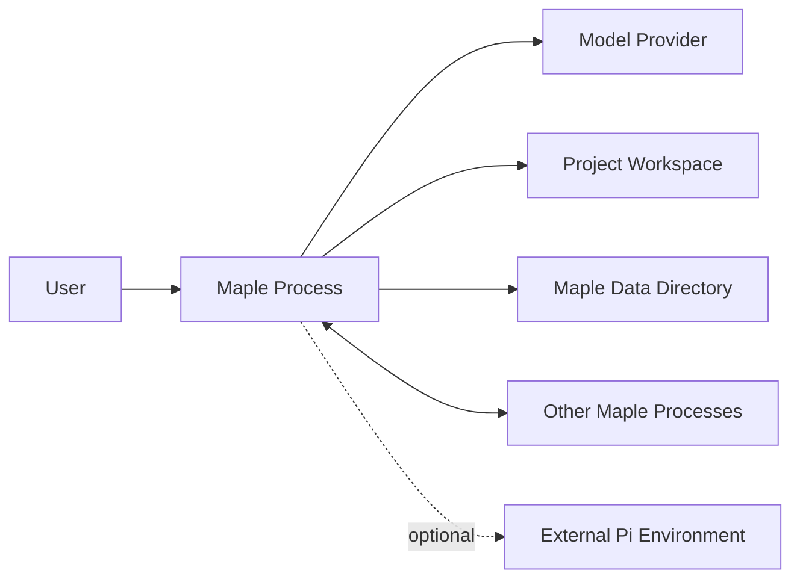

# 03 — System Context, Process Model, and Deployment

## 1. Context diagram

## 2. Process model

- One Maple process corresponds to one active interactive session.
- A process owns its terminal lease and session actor.
- Multiple processes may operate in the same workspace.
- Peer processes are symmetric; no permanent leader is required.
- A process may launch bounded child processes for approved tools.
- Every child process is registered with the process supervisor before execution.
- A process crash must not invalidate already committed journal records.

## 3. Storage roots

Recommended platform roots:
- configuration: platform user config directory under `maple/`;
- durable user data: platform user data directory under `maple/`;
- cache: platform cache directory under `maple/`;
- project-local coordination: `.maple/` inside a workspace when enabled;
- ephemeral runtime state: OS runtime directory under `maple/`.

Project-local state MUST contain no credentials. The user data root is the canonical location for global session metadata and blobs. A project may opt into a local workspace identity and peer coordination directory.

## 4. Single-process mode

Single-process mode is the baseline and must work with:
- no `.maple/` project metadata;
- no peer process;
- no network listener;
- no external agent runtime;
- no optional integration feature.

The runtime should avoid starting mesh watchers or crew schedulers until requested.

## 5. Multi-process collaboration

Each peer has:
- random process instance ID;
- session ID;
- workspace fingerprint;
- protocol version;
- process start timestamp;
- heartbeat sequence;
- capability set.

PID is advisory, not identity. PID reuse is expected. Liveness combines heartbeat age, process start identity where available, and lease expiration.

## 6. Deployment modes

| Mode | Required components | Optional components |
|---|---|---|
| interactive local | CLI, application, domain, TUI, storage | mesh, crew, Pi adapter |
| headless one-shot | CLI, application, domain, provider, tools, storage | TUI, mesh, crew |
| resume | session store, transcript, application | mesh |
| collaboration | native mesh, reservations, peer identity | crew, interop |
| test | fake ports, deterministic clock, temp FS | real provider |
| diagnostic | CLI, config, diagnostics | TUI |

## 7. Startup ordering

1. Parse CLI.
2. Resolve paths and configuration.
3. Initialize redacted diagnostics.
4. Validate environment and workspace.
5. Load secrets through credential resolver.
6. Initialize durable storage.
7. Recover journal/indexes.
8. Construct core services.
9. Initialize requested optional capabilities.
10. Acquire terminal lease if interactive.
11. Start session actor.
12. Render initial view.

Optional capability initialization failure should disable that capability with a clear diagnostic unless the user explicitly invoked it as the primary command.

## 8. Shutdown ordering

1. Stop accepting new user commands.
2. Cancel current turn according to policy.
3. Stop scheduling new tools/tasks.
4. Request cooperative child termination.
5. Wait bounded grace period.
6. Force terminate remaining children where supported.
7. Flush journal and blob metadata.
8. Release reservations and peer leases.
9. Restore terminal.
10. Emit final diagnostic summary.

Every step is idempotent and bounded. Terminal restoration must run even if persistence flush fails.
