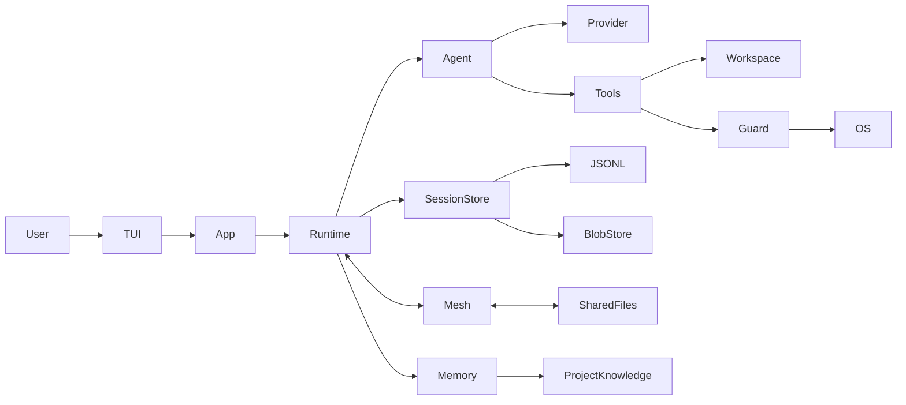
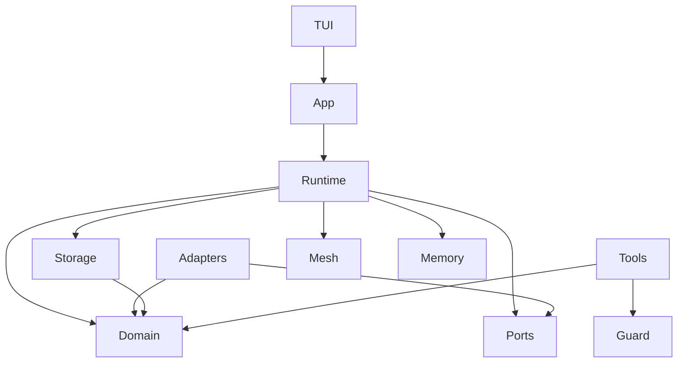

# Legacy V1 reference

This file is preserved for comparison only. Where it conflicts with V2, V2 is authoritative. In particular, `.pi` compatibility is optional and Maple-native behavior is canonical.

# 02 — Architecture principles and system map

## Architectural style
**PROPOSED TARGET:** modular monolith per session process plus a shared file-based peer mesh. Default execution is in-process. Child processes are used selectively for external commands and risky work. No mandatory central daemon.

## Planes
- **Presentation:** TUI toolkit, components, input, overlays, themes, terminal backend.
- **Application:** CLI, bootstrap, dependency composition, command routing, shutdown.
- **Session:** identity, turn state, transcript tree, context, cancellation, usage.
- **Agent:** prompt assembly, model loop, response interpretation, tool planning.
- **Tool:** registry, policy, workspace reads/writes, shell, hashline.
- **Collaboration:** peer registry, inbox, feed, locks, reservations, team memory.
- **Knowledge:** lesson extraction, skills, consolidation, retrieval.
- **Persistence:** JSONL, blobs, indexes, atomic file utilities.
- **Governance:** resource permits, monitoring, security and audit.
- **Operations:** logs, metrics, tests, CI, release and runbooks.

## Context map

## Dependency direction

Domain types must not import UI, provider SDKs, filesystem adapters or OS process APIs. UI consumes view models and emits semantic intents. Adapters implement inward-facing ports. Mesh wire types are distinct from internal domain types. Cyclic crate dependencies are forbidden.

## Ownership
| State/resource | Owner |
|---|---|
| Current session and turn | Session runtime |
| Transcript append | Session store |
| Provider stream | Provider request task |
| Tool process | Tool executor/supervisor |
| Peer registry/inbox/feed | Mesh store |
| Path reservation | Reservation service |
| Project lessons/skills | Memory service |
| Resource permits | Guard |
| Terminal screen | TUI renderer |

## Invariants
- one process owns one active session;
- one writer lease per transcript;
- branch never rewrites parent history;
- every child has timeout and cleanup;
- external content cannot alter policy;
- conflicting writes are denied;
- terminal rendering has no I/O side effects;
- unknown/stale resource measurements fail closed;
- all queues and retained data have explicit bounds.

## Why not daemon-first?
A daemon creates a central failure domain and privileged coordinator, conflicts with symmetric peers and adds deployment/memory overhead. It may be an optional future adapter, never a v0.1 correctness dependency.

## Why not one crate per module?
Crates have compile and API costs. Split only for stable reuse, independent security boundary, distinct platform adapter, or meaningful build/test isolation.
