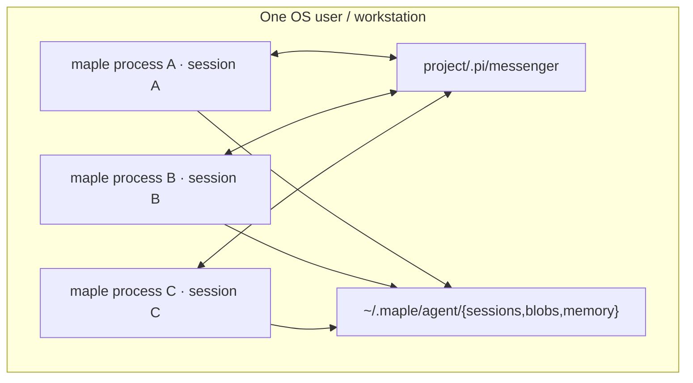
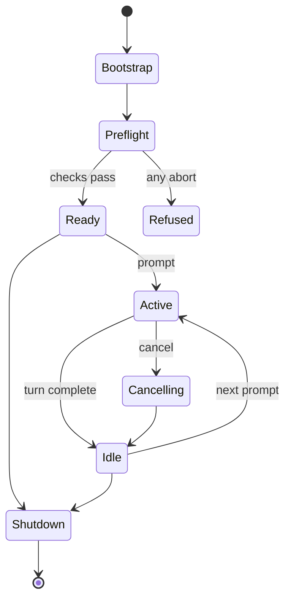

# Legacy V1 reference

This file is preserved for comparison only. Where it conflicts with V2, V2 is authoritative. In particular, `.pi` compatibility is optional and Maple-native behavior is canonical.

# 03 — Deployment topology and process model

## Deployment unit
One native Rust binary per process. User data is rooted at `MAPLE_HOME` (fallback `~/.maple`); project collaboration data lives at `.pi/messenger/`.

## Identity
Each process owns `name`, `pid`, `sessionId` (UUIDv7), canonical `cwd`, model and optional git branch. Session ID is immutable. Name is renameable. PID is a liveness hint and should be paired with process-start identity to mitigate PID reuse.

## Process lifecycle

## Startup order
1. Parse CLI without side effects.
2. Resolve cwd and environment.
3. Load bounded config and initialize redacted diagnostics.
4. Collect resource snapshot and validate freshness.
5. Run operation-specific preflight.
6. Open/create session and acquire writer lease.
7. Validate project root and mesh permissions.
8. Register peer presence only when ready.
9. Lazily initialize provider/tools.
10. Initialize terminal only in interactive mode.
11. Enter event loop.

Failure before registration must not leave a live peer. Failure after registration must run cleanup or leave reclaimable stale state.

## Child process contract
Every child has execution ID, explicit cwd, sanitized environment, process group, bounded stdio, timeout, grace period, resource envelope and orphan cleanup. A subprocess is not automatically a sandbox.

## Filesystem assumptions
v0.1 assumes local filesystem atomic create/rename semantics. Network filesystems and cross-host concurrent access are unsupported until tested. Linux has the strongest resource controls; macOS and Windows require explicit platform adapters. Missing signals are `unknown`, never fabricated zeros.
